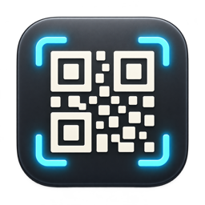

# QR Capture

<p align="center">
  
</p>

**Содержимое QR-кода — сразу в буфере обмена.**

QR Capture — приложение для macOS, которое распознаёт QR-коды на экране и в изображениях из буфера обмена. Работает локально и сохраняет историю последних 100 сканирований.

## Возможности

- Сканирование выбранной области экрана по горячей клавише или нажатию значка в строке меню.
- Распознавание изображения из буфера обмена.
- Автоматическое копирование исходного текста QR-кода.
- История с поиском, просмотром полного текста и повторным копированием.
- Хранение последних 100 сканирований между запусками.
- Удаление отдельных записей и очистка истории с подтверждением.
- Настраиваемое глобальное сочетание клавиш.
- Автозапуск при входе в macOS.
- Поддержка Apple Silicon и Intel.

## Системные требования

- macOS Sequoia 15.2 или новее.
- Разрешение на запись экрана для сканирования области экрана.

Для распознавания изображения из буфера разрешение на запись экрана не требуется.

## Установка

Скопируйте собранное приложение **QR Capture.app** в папку **«Программы»** и запустите его оттуда. Инструкция по самостоятельной сборке приведена ниже.

После запуска в строке меню появятся два значка:

- **История** — открывает окно записей, поиск и настройки.
- **Сканирование** — включает выделение области экрана.

Приложение работает без значка в Dock. Закрытие окна истории не завершает его работу; для завершения нажмите **«Выход»** в этом окне.

## Начало работы

### Сканирование экрана

1. Нажмите **⌃⌥⌘Q** или значок сканирования в строке меню.
2. При первом использовании разрешите запись экрана в **«Системные настройки → Конфиденциальность и безопасность → Запись экрана и системного аудио»**. Если macOS запросит перезапуск приложения, выполните его и повторите сканирование.
3. Выделите QR-код целиком, оставив небольшой отступ вокруг него.
4. Вставьте распознанный текст с помощью **⌘V**.

При успешном сканировании значок ненадолго меняется на галочку, а результат добавляется в историю.

**Escape** отменяет выделение. Если QR-код не найден, приложение не изменяет буфер обмена и историю.

### Распознавание из буфера

1. Скопируйте изображение в буфер обмена. Например, сделайте снимок области экрана сочетанием **⌃⇧⌘4**.
2. Откройте окно истории и нажмите **«Получить из буфера»**.
3. Если QR-код найден, его текст заменит изображение в буфере и появится в истории.

Если в буфере нет изображения или оно не содержит QR-кода, ничего не изменится.

### История

Новые записи отображаются сверху. Поиск работает по полному содержимому QR-кодов. Выберите запись для просмотра полного текста или нажмите кнопку копирования рядом с ней.

Каждое успешное сканирование создаёт отдельную запись, включая повторы. При превышении лимита в 100 записей самая старая удаляется автоматически. Повторное копирование из истории не создаёт новую запись.

### Настройки

Нажмите шестерёнку в окне истории, чтобы изменить сочетание клавиш или включить запуск при входе в macOS. Автозапуск по умолчанию выключен.

Новое сочетание должно содержать **⌘**, **⌃** или **⌥**. Нажмите **Escape**, чтобы отменить его ввод.

## Приватность

QR Capture выполняет распознавание с помощью Apple Vision на устройстве.

- Нет сетевых запросов, аналитики, удалённой синхронизации и проверки обновлений.
- Включена песочница macOS (App Sandbox); разрешения на входящие и исходящие сетевые подключения отсутствуют.
- Изображения обрабатываются в памяти и не сохраняются приложением на диск.
- Захват экрана выполняется только по команде пользователя. Перед выделением приложение получает снимки подключённых экранов в память; распознаванию передаётся выбранный фрагмент.
- Изображение из буфера читается только при нажатии **«Получить из буфера»**.
- История и настройки хранятся локально в контейнере приложения. iCloud не используется.

В историю записываются текст QR-кода и время сканирования. Отдельного шифрования истории нет: если код содержит конфиденциальные данные, они также сохраняются в истории.

Распознанный текст попадает в обычный системный буфер обмена. Установленные менеджеры буфера и системный Universal Clipboard могут обрабатывать его согласно своим настройкам.

## Особенности

- Поддерживаются QR-коды. Другие виды штрихкодов не распознаются.
- Если в изображении несколько QR-кодов, используется первый результат Apple Vision. Пространственный порядок выбора не гарантируется.
- Ссылки копируются как текст и автоматически не открываются.
- Выделение области выполняется в пределах одного монитора.
- Положение и видимость значков в строке меню определяются macOS и доступным местом.

## Сборка из исходников

Требуется **Xcode 16.2 или новее**. Сторонних зависимостей нет.

Откройте `QRCapture.xcodeproj` и выберите схему `QRCapture` либо выполните из корня репозитория:

```sh
xcodebuild -project QRCapture.xcodeproj \
  -scheme QRCapture \
  -configuration Release \
  -derivedDataPath build/DerivedData \
  -destination 'generic/platform=macOS' \
  build
```

Готовое приложение:

```text
build/DerivedData/Build/Products/Release/QR Capture.app
```

Release-сборка содержит версии для Apple Silicon и Intel. Проект настроен на локальную ad-hoc подпись. Такая подпись не является Developer ID-подписью или нотариальным заверением Apple; для распространения готовых сборок с проверкой Gatekeeper требуется соответствующая подпись и notarization.

Перед заменой установленной копии завершите приложение. После пересборки macOS может повторно запросить разрешение на запись экрана.
